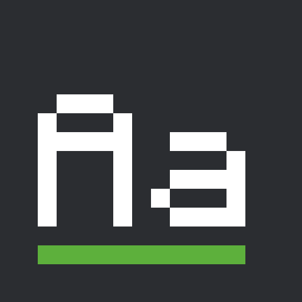

# Monocraft Font

A resource pack for Minecraft 26.3 that draws all of the game's text — menus, chat, signs, item
names — in [Monocraft](https://github.com/IdreesInc/Monocraft), a monospaced font made in the
style of the Minecraft UI typeface. It sits on exactly the same pixel grid as the vanilla font,
so text stays sharp at every GUI scale.

*[Po polsku niżej.](#po-polsku)*

<p></p>


Tested on a MacBook Air M1 with Minecraft 26.3, October 2026, at GUI scale 3, in English and
Polish; the screenshots above are taken in the game, pixel for pixel.

## Install

1. Get the pack from [Modrinth](https://modrinth.com/resourcepack/monocraft-font): in the Modrinth
   App search for **Monocraft Font** and click **Install**, or download the `.zip` and put it,
   still zipped, in the profile's `resourcepacks` folder.
2. In the game: **Options → Resource Packs**, move **Monocraft Font** to the right-hand list and
   click **Done**.

## Good to know

- **Every pixel lands on a whole screen pixel.** Monocraft centres a few narrow letters (f, i, k,
  l, t and their accented forms) half a pixel off the grid, which Minecraft would draw as uneven
  stems; this pack moves those 30 glyphs half a pixel to the right.
- **Long labels come out a little wider.** Monocraft is monospaced, so every letter takes the same
  width; a few long button labels scroll, the same way they do in vanilla when they don't fit.
- **Most languages are covered.** Latin with accents (Polish, German, French and more), Cyrillic,
  Greek and more; anything Monocraft lacks is drawn by the vanilla font.
- **The rest stays vanilla.** The Force Unicode Font option and the enchanting table and Illager
  fonts are not touched.
- **Other packs that change the font** win only if they sit above Monocraft Font in the list; put
  it at the top to be sure.

## Building

```
./publish.sh build
```

The zip ends up in `dist/`. `./publish.sh` without `build` also uploads it to Modrinth as the
version in `VERSION` (set `CHANGELOG="what changed"` first); the token is read from
`MODRINTH_TOKEN`, or else from `~/.config/modrinth/token`.

## Credits and license

Monocraft is made by Idrees Hassan and licensed under the SIL Open Font License 1.1 — its license
is in [pack/LICENSE-Monocraft.txt](pack/LICENSE-Monocraft.txt). The copy in this pack is modified:
30 glyphs are moved half a pixel to the right onto the pixel grid and the TrueType hinting tables
are removed; nothing else is changed, and the modified font stays under the same license. This
pack is not affiliated with the Monocraft project.

The rest of this repository is MIT licensed, see [LICENSE](LICENSE).

Not an official Minecraft product. Not approved by or associated with Mojang or Microsoft.

---

## Po polsku

Paczka zasobów do Minecrafta 26.3, która rysuje cały tekst w grze — menu, czat, tabliczki, nazwy
przedmiotów — czcionką [Monocraft](https://github.com/IdreesInc/Monocraft), czyli czcionką
o stałej szerokości znaków w stylu Minecrafta. Leży dokładnie na tej samej siatce pikseli co
zwykła czcionka gry, więc tekst jest ostry przy każdej skali interfejsu.

Instalacja: pobierz paczkę z [Modrinth](https://modrinth.com/resourcepack/monocraft-font)
(w Modrinth App wyszukaj **Monocraft Font** i kliknij **Install** albo wrzuć pobrany `.zip`, bez
rozpakowywania, do folderu `resourcepacks`), a potem w grze **Opcje → Paczki zasobów**, przenieś
**Monocraft Font** na prawą listę i kliknij **Gotowe**.

- **Każdy piksel trafia w pełny piksel ekranu** — Monocraft wyśrodkowuje kilka wąskich liter
  (f, i, k, l, t i ich wersje z akcentami) o pół piksela poza siatką; paczka przesuwa te 30 znaków
  o pół piksela w prawo.
- **Długie napisy są trochę szersze** — każda litera ma tę samą szerokość, więc kilka długich
  przycisków przewija tekst, tak jak w vanilli, gdy się nie mieści.
- **Polskie znaki i większość języków** są narysowane Monocraftem; czego brakuje, rysuje zwykła
  czcionka gry.
- **Reszta zostaje jak w vanilli** — opcja Wymuś czcionkę Unicode oraz czcionki stołu do zaklinania
  i illagerów są nietknięte.
- **Inne paczki zmieniające czcionkę** wygrywają tylko, gdy są wyżej na liście — ustaw Monocraft
  Font na samej górze.

Monocraft stworzył Idrees Hassan, licencja SIL Open Font License 1.1; kopia w paczce ma 30 znaków
przesuniętych o pół piksela i nic poza tym. Paczka nie jest powiązana z projektem Monocraft.
Reszta repozytorium na licencji MIT. To nie jest oficjalny produkt Minecraft; nie jest
zatwierdzony przez Mojang ani Microsoft ani z nimi powiązany.
