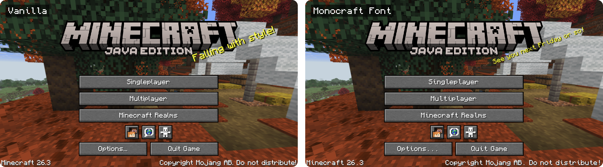

# Monocraft Font

[Modrinth](https://modrinth.com/resourcepack/monocraft-font) · A resource pack for Minecraft 26.3 that draws all of the game's text in [Monocraft](https://github.com/IdreesInc/Monocraft), a Minecraft-style monospaced font.



- Pixel-exact: the font is set to the same 7-pixel letter height and 1-pixel grid as the vanilla font, so text stays sharp at every GUI scale. Monocraft draws a few narrow letters (f, i, k, l, t and their accented forms) half a pixel off the grid to centre them; this pack moves them half a pixel right so every pixel lands on a whole screen pixel
- Covers Latin, Polish and other accented letters, Cyrillic, Greek and more; anything Monocraft lacks falls back to the vanilla font
- Leaves the Force Unicode Font option, the enchanting table and Illager fonts alone
- Monocraft is monospaced, so long button labels come out a little wider than in vanilla

## Building

```
./publish.sh build
```

The zip ends up in `dist/`. `./publish.sh` without arguments also uploads it to Modrinth as the version in `VERSION`; the token is read from `MODRINTH_TOKEN`, or else from `~/.config/modrinth/token`.

## Credits and license

Monocraft is made by Idrees Hassan and licensed under the SIL Open Font License 1.1, with its license in `pack/LICENSE-Monocraft.txt`. The copy in this pack is modified: 30 glyphs are shifted half a pixel to the right onto the pixel grid, and the TrueType hinting tables are removed; nothing else is changed. The modified font is released under the same license. This pack is not affiliated with the Monocraft project. The rest of this repository is MIT licensed.

Not an official Minecraft product. Not approved by or associated with Mojang or Microsoft.
